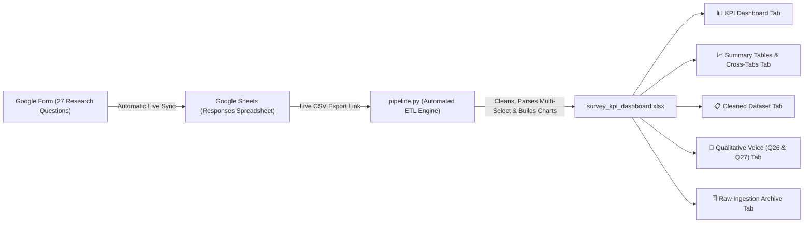

# University Life Management Survey: Complete Google Form & Data Pipeline Guide

**Research Topic**: *Assessing the Need for a University Life Management Foundation Course: Exploring Students’ Experiences, Challenges and Support Needs*

This document provides:
1. **Google Form Blueprint**: The exact 9 sections, question types, and option settings to set up in Google Forms.
2. **Automated Pipeline Flow**: How responses sync from Google Forms to Google Sheets, get cleaned by `pipeline.py`, and generate the **Executive Research Excel KPI Dashboard** (`survey_kpi_dashboard.xlsx`).

---

## 🏗️ Architecture & Pipeline Flow



---

## Part 1: Google Form Question-by-Question Setup Blueprint

Go to [forms.google.com](https://forms.google.com) > Click **Blank form**.
- **Form Title**: `University Life Management Survey`
- **Form Description**:
  *Assessing the Need for a University Life Management Foundation Course: Exploring Students’ Experiences, Challenges and Support Needs. Estimated completion time: 5 minutes.*

### SECTION 1 — PARTICIPANT PROFILE
- **Q1**: `1. Name (Optional)` -> **Short answer**
- **Q2**: `2. Gender` -> **Multiple choice**:
  - `Female`
  - `Male`
  - `Prefer not to say`
  - `Other` *(Check "Add Other")*
- **Q3**: `3. Current Level of Study` -> **Multiple choice**:
  - `First Year`
  - `Second Year`
  - `Third Year`
  - `Fourth Year`
- **Q4**: `4. Type of Institution` -> **Multiple choice**:
  - `Public university`
  - `Private university`
- **Q5**: `5. Programme/Field of Study (Optional)` -> **Short answer**
- **Q6**: `6. Age Group (Optional)` -> **Multiple choice** or **Short answer**:
  - `17-19`
  - `20-22`
  - `23-25`
  - `26+`

---

### SECTION 2 — UNIVERSITY LIFE EXPERIENCE
- **Question 1**: `Beyond attending classes, completing assignments and taking examinations, which areas of university life do you currently have to manage?`
  - **Type**: **Checkboxes** (Select all that apply)
  - Options:
    - `Time management`
    - `Academic organization`
    - `Financial management`
    - `Family and household responsibilities`
    - `Mental and emotional wellbeing`
    - `Personal growth and self-management`
    - `Social relationships`
    - `Extracurricular involvement`
    - `Leadership and collaboration`
    - `Career preparation`
    - `Other`
- **Question 2**: `Overall, how prepared do you feel to manage the different demands of university life beyond your academic coursework?`
  - **Type**: **Multiple choice**:
    - `Very well prepared`
    - `Moderately prepared`
    - `Not at all prepared`
- **Question 3**: `How did you learn most of the skills you currently use to manage university life?`
  - **Type**: **Checkboxes** (Select up to 3):
    - `University programmes or services`
    - `Family & Friends`
    - `Student associations or clubs`
    - `Mentors or role models`
    - `Workshops or training`
    - `Social media or online resources`
    - `Personal experience`

---

### SECTION 3 — TIME MANAGEMENT & ORGANIZATION
- **Question 4**: `How would you describe the way you currently manage your time and responsibilities at university?`
  - **Type**: **Multiple choice**:
    - `I have a clear system and manage them well`
    - `I have a system but sometimes struggle to follow it`
    - `I manage things as they come`
    - `I often struggle to balance my responsibilities`
    - `I don't have a particular system`
- **Question 5**: `Which areas do you find most difficult to balance alongside your academic work?`
  - **Type**: **Checkboxes** (Select up to 3):
    - `Personal study and assignments`
    - `Paid work or running a business`
    - `Family duties and household tasks`
    - `Friendships and relationships`
    - `Student clubs and extracurricular activities`
    - `Rest and personal time`
    - `Exercise and physical health`
    - `Other`
- **Question 6**: `Have you received any structured guidance or training from your university on time management, planning or organizing your responsibilities?`
  - **Type**: **Multiple choice**:
    - `Yes`
    - `No`

---

### SECTION 4 — PERSONAL DEVELOPMENT & SELF-MANAGEMENT
- **Question 7**: `Which personal development areas do you feel are important for your success at university and beyond?`
  - **Type**: **Checkboxes** (Select up to 4):
    - `Goal setting and planning`
    - `Self-confidence and self-awareness`
    - `Decision-making`
    - `Communication skills`
    - `Leadership`
    - `Building healthy habits and discipline`
    - `Problem-solving`
    - `Independence and taking responsibility`
    - `Identifying my strengths, interests and abilities`
    - `Other`
- **Question 8**: `How much guidance or opportunity have you received through your university to develop these skills?`
  - **Type**: **Multiple choice**:
    - `A lot`
    - `Some`
    - `Very little`
    - `None`
    - `I'm not sure`
- **Question 9**: `Which of these personal development areas would you most like more structured guidance on?`
  - **Type**: **Checkboxes** (Select up to 3):
    - `Goal setting and planning`
    - `Confidence and self-awareness`
    - `Decision-making`
    - `Communication`
    - `Leadership`
    - `Discipline and healthy habits`
    - `Problem-solving`
    - `Independence`
    - `Identifying my strengths and career interests`
    - `Other`

---

### SECTION 5 — WELLBEING & MANAGING UNIVERSITY PRESSURE
- **Question 10**: `When you experience stress or feel overwhelmed by university responsibilities, what do you usually do?`
  - **Type**: **Checkboxes** (Select up to 3):
    - `Talk to family or friends`
    - `Seek the university counselling department`
    - `Take time to rest or disconnect`
    - `Exercise or engage in other activities`
    - `Pray or engage in spiritual activities`
    - `Try to solve the problem myself`
    - `Ignore it and continue with my responsibilities`
    - `I am not sure what to do`
    - `Other`
- **Question 11**: `How much guidance or support does your university provide on managing stress, maintaining wellbeing and achieving balance in university life?`
  - **Type**: **Multiple choice**:
    - `A lot`
    - `Very little`
    - `None`
    - `I'm not sure`

---

### SECTION 6 — FINANCIAL MANAGEMENT
- **Question 12**: `Which aspects of managing money are most challenging for you as a university student?`
  - **Type**: **Checkboxes** (Select up to 3):
    - `Creating and following a budget`
    - `Managing daily expenses`
    - `Saving money`
    - `Managing unexpected expenses`
    - `Balancing needs and wants`
    - `Managing financial support/allowance`
    - `Paying for academic needs`
    - `Managing transport and food expenses`
    - `I don't currently experience significant difficulty`
    - `Other`
- **Question 13**: `Where have you learned most of what you know about managing money?`
  - **Type**: **Checkboxes** (Select up to 2):
    - `Family`
    - `University`
    - `Friends/peers`
    - `Personal experience`
    - `Social media/internet`
    - `Workshops or training`
    - `Books/courses`
    - `I have mostly had to figure it out myself`
    - `I have not received any guidance`
    - `Other`
- **Question 14**: `How useful would structured guidance on financial management be to you as a university student?`
  - **Type**: **Multiple choice**:
    - `Very useful`
    - `Slightly useful`
    - `Not sure`
    - `Not useful at all`

---

### SECTION 7 — RELATIONSHIPS, SOCIAL LIFE & STUDENT ENGAGEMENT
- **Question 15**: `Which aspects of social and student life are you currently involved in or have to manage?`
  - **Type**: **Checkboxes** (Select all that apply):
    - `Friendships and peer relationships`
    - `Family relationships/responsibilities`
    - `Student organizations or clubs`
    - `Volunteering/community activities`
    - `Leadership roles`
    - `Religious or faith-based activities`
    - `Sports or recreational activities`
    - `Work/business alongside university`
    - `Social activities`
    - `I am not currently involved in activities outside my coursework`
    - `Other`
- **Question 16**: `How much guidance or support have you received from your university on getting involved in student activities, developing leadership/teamwork skills, or balancing these activities with your studies?`
  - **Type**: **Multiple choice**:
    - `A lot`
    - `Very little`
    - `None`
    - `I'm not sure`
- **Question 17**: `Which areas would you find useful to receive more structured guidance on?`
  - **Type**: **Checkboxes** (Select up to 3):
    - `Building healthy relationships`
    - `Communication`
    - `Handling conflict`
    - `Leadership`
    - `Teamwork`
    - `Finding and using student opportunities`
    - `Getting involved in organizations/community activities`
    - `Balancing activities with academic responsibilities`
    - `Building a sense of belonging/community`
    - `None`
    - `Other`

---

### SECTION 8 — CAREER & FUTURE PREPARATION
- **Question 18**: `How prepared do you currently feel for life after university?`
  - **Type**: **Multiple choice**:
    - `Very prepared`
    - `Somewhat prepared`
    - `Not prepared at all`
- **Question 19**: `Which areas of career and future preparation would you find most useful to receive guidance on?`
  - **Type**: **Checkboxes** (Select up to 4):
    - `Identifying career interests and direction`
    - `CV/resume and application writing`
    - `Job searching and employment opportunities`
    - `Interview skills`
    - `Networking and professional relationships`
    - `Internships and work experience`
    - `Professional communication and workplace skills`
    - `Entrepreneurship/self-employment`
    - `Further study and scholarships`
    - `Building a professional profile/online presence`
    - `Financial preparation for working life`
    - `Other`
- **Question 20**: `How much guidance or support does your university currently provide to help students prepare for their careers and life after graduation?`
  - **Type**: **Multiple choice**:
    - `A lot`
    - `Very little`
    - `None`
    - `I'm not sure`
- **Question 21**: `Where do you currently get most of your career or future-related guidance?`
  - **Type**: **Checkboxes** (Select up to 3):
    - `University/lecturers`
    - `Career services`
    - `Family`
    - `Friends/peers`
    - `Mentors`
    - `Professional networks`
    - `Social media/internet`
    - `Personal experience`
    - `I mostly figure it out myself`
    - `I currently don't receive much guidance`
    - `Other`

---

### SECTION 9 — PERCEIVED GAPS & NEED FOR STRUCTURED SUPPORT
- **Question 22**: `Overall, how adequately do you feel your university prepares you to manage the different aspects of university life beyond your academic courses?`
  - **Type**: **Multiple choice**:
    - `Very adequately`
    - `Inadequately`
    - `I'm not sure`
- **Question 23**: `Which areas of university life do you feel students need more structured guidance or preparation in?`
  - **Type**: **Checkboxes** (Select up to 5):
    - `Time management & organization`
    - `Personal development`
    - `Wellbeing & managing stress`
    - `Financial management`
    - `Relationships & communication`
    - `Student organizations & leadership`
    - `Career & professional preparation`
    - `Preparing for life after graduation`
    - `Decision-making & independence`
    - `Other`
- **Question 24 (The Central Question)**: `If your university offered a structured “University Life Management Foundation Course” to help students develop practical skills for navigating university life beyond their academic subjects, how useful do you think it would be?`
  - **Type**: **Multiple choice**:
    - `Very useful`
    - `Somewhat useful`
    - `Not useful at all`
    - `I'm not sure`
- **Question 25**: `What format would you prefer for learning these skills?`
  - **Type**: **Checkboxes** (Select up to 2):
    - `A course integrated into the university curriculum`
    - `Short workshops`
    - `Orientation programme`
    - `Mentorship programme`
    - `Peer-support programme`
    - `Practical projects/activities`
    - `One-to-one guidance`
    - `Other`
- **Question 26 (Open-ended)**: `What is one thing you wish someone had taught or guided you on before or during your university experience?`
  - **Type**: **Paragraph**
- **Question 27 (Optional)**: `Is there anything else you believe universities could do to better prepare students for university life and life after graduation?`
  - **Type**: **Paragraph**

---

## Part 2: Linking Google Form to Google Sheets

1. In Google Forms, click the **Responses** tab at the top.
2. Click the green **Link to Sheets** icon.
3. Select **Create a new spreadsheet** (e.g. `University Life Management Survey (Responses)`) and click **Create**.
4. Responses will now stream into this sheet automatically in real-time.

---

## Part 3: Connecting to the Pipeline

1. In your linked Google Sheet, click the blue **Share** button (top right).
2. Under *General Access*, set it to: **"Anyone with the link can view"** > click **Copy Link**.
3. Open [`config.json`](file:///c:/Users/SWARAY/Downloads/gifty%20forms/config.json) in your project folder and paste your link:
   ```json
   {
     "google_sheet_url": "PASTE_YOUR_GOOGLE_SHEET_URL_HERE",
     "auto_open_excel": true
   }
   ```

---

## Part 4: Running the Pipeline & Opening the Dashboard

- **1-Click Execution**: Double-click [**`run_pipeline.bat`**](file:///c:/Users/SWARAY/Downloads/gifty%20forms/run_pipeline.bat) in Windows Explorer.
- **Or via Terminal**:
  ```powershell
  python pipeline.py --open
  ```
- **Or testing with mock data**:
  ```powershell
  python pipeline.py --mock --open
  ```

---

## Part 5: Structure of the Generated Excel Workbook

[`survey_kpi_dashboard.xlsx`](file:///c:/Users/SWARAY/Downloads/gifty%20forms/output/survey_kpi_dashboard.xlsx) contains 5 professional tabs:

1. **`KPI Dashboard`**:
   - **Executive Academic Header Banner**: Title, sample size counter ($N$).
   - **6 High-Impact Metric Scorecards**:
     - **Sample Participants ($N$)**
     - **Foundation Course Endorsement** (% Very Useful + Somewhat Useful)
     - **Institutional Preparation Deficit** (% Inadequately Prepared)
     - **Post-Graduation Unpreparedness** (% Not Prepared at all)
     - **Time Management Guidance Void** (% Received Zero Training)
     - **Financial Guidance Need** (% Very Useful)
   - **6 Research Charts**:
     - *Chart 1*: Foundation Course Utility Endorsement (Donut Chart - Q24)
     - *Chart 2*: Priority Life Areas Demanded for Guidance (Ranked Bar Chart - Q23)
     - *Chart 3*: Institutional Support Deficit Across 5 Pillars (Column Chart)
     - *Chart 4*: Preferred Course Format (Bar Chart - Q25)
     - *Chart 5*: Post-Graduation Unpreparedness by Level of Study (Clustered Column)
     - *Chart 6*: Demands & Pressures Managed Beyond Classes (Bar Chart - Q1)
   - **Executive Research Summary Box**: Formulated takeaway bullets ready for academic papers and faculty presentations.
2. **`Summary Tables`**: Aggregate frequency and cross-tab tables that feed all charts.
3. **`Cleaned Dataset`**: Clean, normalized tabular data with response IDs and formatted columns.
4. **`Qualitative Voice (Q26 & Q27)`**: Dedicated tab of student quotes and open-ended recommendations filtered by Level of Study and Programme.
5. **`Raw Ingestion Archive`**: Preserved raw Google Forms export for data auditability.
